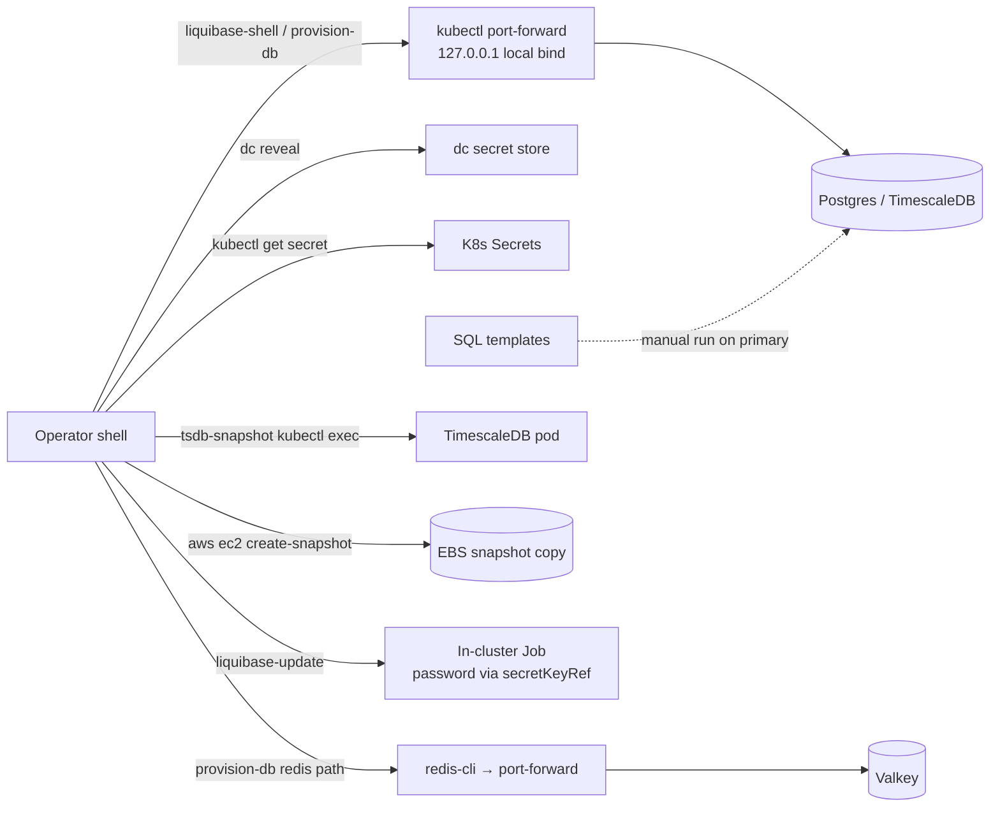

# Threat Model — database-tools

## Overview

database-tools is a **local, operator-side CLI toolkit** (Bash + SQL templates) for
administering K8s-hosted PostgreSQL/TimescaleDB and Valkey. It runs no server and
listens on no network port of its own. Its crown jewels are **the database
credentials and cluster access of the invoking operator**: every tool inherits the
authority of the operator's `KUBECONFIG` (and, for snapshots, AWS credentials) and
adds no authorization layer of its own.

Trust boundaries, as verifiable from source:

1. **Operator workstation ↔ cluster API** — `kubectl` calls (secret reads,
   port-forwards, exec, Job applies) authenticated by the operator's kubeconfig.
2. **Workstation ↔ databases** — `kubectl port-forward` tunnels (kubectl binds the
   local end to `127.0.0.1` by default; scripts pass no widen flag) and, for
   `tsdb-snapshot`, `kubectl exec` psql sessions on the DB pod itself.
3. **Workstation ↔ AWS** — `aws ec2 create-snapshot` copies the full TimescaleDB
   volume into the AWS account (region: `AWS_DEFAULT_REGION`/`K8_AWS_REGION`).
4. **Workstation ↔ local secret stores** — `dc` (direnv-config) reveals app-role
   passwords for `provision-db`; K8s Secrets supply admin/password material.

→ *Component map: [PROJ-ARCH.md](PROJ-ARCH.md) · directories: [PROJ-LAYOUT.md](PROJ-LAYOUT.md)*

## Attack Surface

Entry points are all local CLI invocations; the surface below is enumerated per
tool in the register.

## Vulnerability Register

| ID | Severity | STRIDE | Component | Status |
|----|----------|--------|-----------|--------|
| T-001 | Medium | Information disclosure | `liquibase-shell --shell` exports `PGPASSWORD` (plus `PG*`, `LB_*`) into the child environment and keeps a `liquibase.properties` file containing the JDBC password in a `mktemp -d` dir for the whole session | Open — accepted by design (operator convenience); dir is 0700, EXIT/INT/TERM trap removes it |
| T-002 | Low | Information disclosure | `provision-db` passes Valkey admin and user passwords as `redis-cli` argv (`-a "$REDIS_ADMIN_PASS"`, `> "$REDIS_USER_PASS"`) — visible in local process listings to same-host users | Open |
| T-003 | Medium | Elevation of privilege (operator/agent abuse) | `--yes` / `LIQUIBASE_ASSUME_YES=1` bypasses the destructive-confirm gates (`update`, rollback, `drop-all`, `clear-checksums`) on `safety: destructive` targets | Mitigated — strictly opt-in; `readonly` whitelist mode available; residual: anything holding the env var runs unfenced |
| T-004 | High | Elevation of privilege / Information disclosure | Compromise of the operator's `KUBECONFIG` yields full DB admin **through these tools by design** (secret reads, port-forwards, `kubectl exec`, Job applies) | Accepted — boundary is workstation security; the toolkit adds no second factor |
| T-005 | Medium | Information disclosure | `tsdb-snapshot` copies the entire DB volume into an AWS EBS snapshot — anyone who can read that snapshot reads the data | Partially mitigated — snapshot inherits volume encryption and AWS IAM scope; retention/lifecycle is not managed by this package |
| T-006 | Low | Tampering | SQL templates (`pgbouncer-auth-setup.sql`, `sql/create-migrate-user.sql`) are hand-run with manual `${VAR}` substitution — wrong-target execution or leftover placeholders are possible | Mitigated — not installed by `make install`, run-on-primary-only documented; no tooling enforcement |
| T-007 | Low | Elevation of privilege | `liquibase-update` applies an in-cluster Job with `runAsUser: 0` in the `gnp` namespace | Accepted — legacy path; `backoffLimit: 0` + `ttlSecondsAfterFinished: 3600` bound its lifetime |

## Mitigation Coverage

Controls observed in source, with the register entries they cover:

- **Port-forward binds `127.0.0.1`** (kubectl default; no widen flag passed) — limits
  tunnel exposure to the operator host → T-001, T-004.
- **Liquibase safety modes** — `readonly` whitelist (`status diff validate history
  update-sql rollback-count-sql changelog-sync-sql`) and `destructive` confirms;
  default `normal` → T-003.
- **Cleanup traps** (EXIT/INT/TERM) — kill port-forwards, remove the temp
  properties dir, and always release Postgres backup mode → T-001, T-005 integrity.
- **`liquibase-update` secret handling** — the Job's ConfigMap carries only a
  `${LIQUIBASE_COMMAND_PASSWORD}` placeholder; the password arrives via
  `secretKeyRef` env, and the ConfigMap is deleted after success → keeps T-004's
  blast radius off persistent ConfigMaps.
- **Docker fallback hardening** — the properties dir is mounted read-only into the
  `liquibase/liquibase:4.29` container → T-001.
- **Snapshot consistency guard** — `pg_is_in_recovery` check + session-scoped
  `pg_backup_start`/`stop`; `crash_only` is opt-in for standbys → T-005.

4 mitigated/partially mitigated · 2 open (accepted-by-design) · 1 accepted. No
tracking tickets — open items are documented behavior, not defects scheduled for fix.

## Residual Risk

The package assumes a **single-operator, admin-equivalent trust model**: anyone who
can invoke these tools already holds cluster credentials that make the tools'
authority redundant. Destructive Liquibase operations are audited only by
Liquibase's own `DATABASECHANGELOG` history and shell output — there is no
package-level audit log of `--yes` runs, snapshot creation, or provisioning
actions. Local process-listing exposure of redis-cli argv (T-002) is accepted for
single-user workstations; multi-user hosts should avoid `provision-db --redis-only`.

→ *Config/credential field reference: [PROJ-SCHEMA.md](PROJ-SCHEMA.md)*
